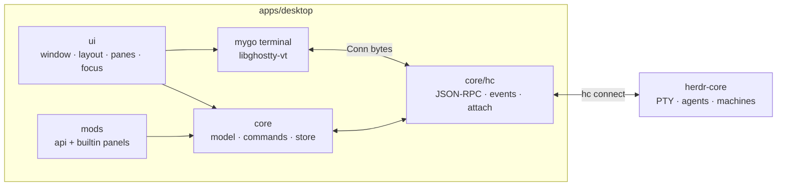

# Technical design

## Goals

- A native mygo app: one window, Go views, no web frontend, no cgo.
- A client of herdr-core: the core owns PTYs, terminal buffers, agents and
  machines; hiik owns the window, layout, focus, theme and commands.
- Full shipped surface (terminal, spaces/tabs/panes, agents, palette,
  settings, files, changes, worktrees, machines, updates) with a Go mod
  system for extension.
- Boring, testable packages with disjoint ownership so work can run in
  parallel.

Non-goals: a scripting runtime, web pages, a second core, code signing.

## Runtime



The window rebuilds a `ui.View` each frame. Terminals keep their own state
in the terminal plugin; the app model holds spaces, tabs, panes and agents.

## Repository layout

```
apps/desktop/            the only desktop app, one Go module
  main.go                wiring only
  core/                  model, commands, store
  core/hc/               the herdr-core client
  ui/                    shell, layout, panes, focus, keys
  mods/api/              the mod contract (no app imports)
  mods/builtin/          shipped panels and commands
contracts/               core OpenRPC schema, hiik state schema
docs/                    this design, requirements, status, subsystems
scripts/                 check programs, a separate Go module
```

`core` never imports `ui`; `ui` imports `core`; mods import `mods/api` and
mygo's `ui`. The app module path is `hiik`, rooted at `apps/desktop`.

## Frozen interfaces

Workstreams code against these. Changing one is a design change and updates
the subsystem page.

### `mods/api`

```go
type Mod struct {
    ID, Name string
    Panels   []Panel
    Commands []Command
}
type Panel struct {
    ID, Title string
    Render    func(*RenderContext)
}
type RenderContext struct {
    C     *mygo/ui.Context
    App   App
    Props map[string]any
}
type Command struct {
    ID, Title string
    Keys      []Binding
    Run       func(App, map[string]any) error
}
type App interface {
    Spaces() []Space
    Agents() []Agent
    ActiveSpace() string
    Run(name string, args map[string]any) error
}
```

Models: `Space{ID, Name, Folder, Machine, Tabs, Active}`, `Tab{ID, Name,
Root, Focus}`, `Node{ID, Vertical, Ratio, A, B, Terminal}`,
`Agent{Address, App, Title, Space, Tab, Status, Pinned, Seen, Turn}`.

Registration is `api.Register(Mod)` from `init`. Duplicate IDs panic at
startup. All mods are compiled in; there is no runtime loader.

### `core/hc`

```go
func Dial(ctx context.Context, opts Options) (*Client, error)
func (c *Client) Close() error
func (c *Client) Hello() Hello
func (c *Client) Call(ctx context.Context, method string, params, result any) error
func (c *Client) Subscribe(ctx context.Context) (*Subscription, error)
func (c *Client) List(ctx context.Context, all bool) ([]Terminal, error)
func (c *Client) Run(ctx context.Context, req RunRequest) (Terminal, error)
func (c *Client) Kill(ctx context.Context, address string) error
func (c *Client) Label(ctx context.Context, address string, labels map[string]string) error
func (c *Client) Attach(ctx context.Context, req AttachRequest) (*Attachment, error)
func (c *Client) Lost() <-chan struct{}
```

`Attachment.Conn` is an `io.ReadWriteCloser` with `Resize`, `ResizePixels`
and `UseTheme`, made for `terminal.Options{Conn: ..., ResizeByConn: true}`.
`Subscription` carries the snapshot, an event channel and a close function.

### `core.App`

```go
func New() *App
func (a *App) Start(ctx context.Context) error
func (a *App) Close()
func (a *App) Spaces() []api.Space
func (a *App) Agents() []api.Agent
func (a *App) ActiveSpace() string
func (a *App) Run(name string, args map[string]any) error
func (a *App) Commands() []api.Command
func (a *App) UIState() api.UIState
func (a *App) SetUIState(api.UIState)
```

`Run` queues a command; it never blocks the frame's build pass. UI reads
snapshots; mutations are applied by the core and wake the window once.

## Threading and events

- One goroutine reads core frames and demuxes RPC replies, event lines and
  terminal DATA.
- RPC calls are synchronous per caller with a timeout; the UI calls them
  from command goroutines, never from the build pass.
- The subscription goroutine applies events to the model under the app lock.
- After a batch, it calls `win.Update` **once**, at most every ~16 ms.
  Terminal output never triggers an app-level update; the terminal view
  invalidates itself.
- Mods and commands run off the build pass. `Run` enqueues, then a worker
  applies the command and wakes once.

## Terminal lifecycle

1. A pane becomes visible and has an address but no attachment.
2. `hc.Attach` with the pane's last known size (or 80×24 before first
   layout) and `history: 2000`.
3. `terminal.New(Options{Conn: at.Conn, ResizeByConn: true, ...})`; the
   view's first layout tells the core the real size.
4. `Read` sends CREDIT for exactly the bytes read; start at 1 MiB.
5. `Resize` sends RESIZE. With `ResizeByConn`, the screen keeps its size
   until the core acknowledges; the M0 probe pins this behavior.
6. Hiding a tab detaches: close the terminal, close the attachment. The
   core keeps the program and its screen.
7. Losing the core closes every `Conn`. The UI shows a reconnect banner;
   after `Dial` succeeds, visible panes attach again and receive a first
   paint.
8. A terminal that exits shows its code and Restart/Close; the pane is not
   silently removed.

## Model and layout

- `Space -> Tab -> Node`; a node is a leaf terminal or a binary split with
  a ratio. This mirrors the operations: split, close, zoom, focus, swap.
- New space: one tab, one leaf. New tab: one leaf. Split: replace the leaf
  with a split node and a new leaf.
- Focus and zoom are per tab; the active space and tab are app state.
- Sizes persist with the tree. UI widths and window geometry persist in
  `UIState`.
- Missing terminals (lost after a core restart) keep the pane with a
  "terminated" state and a restart action, so the layout does not collapse.

## Persistence

`~/.config/hiik/state.json` (or `$HIIK_HOME/state.json`):

```json
{
  "version": 1,
  "spaces": [ ... ],
  "active": "s1",
  "ui": { "sidebarW": 240 }
}
```

Writes are atomic (temp file + rename), debounced ~200 ms, and versioned.
`settings.json` holds fonts, theme, appearance, keymap overrides, core path,
telemetry and privacy. `keys.json` may override bindings. Invalid files are
kept aside as `*.corrupt-<time>` and defaults are used.

## Mod system

- Compile-time Go packages; no scripting, no ABI, no sandbox.
- A mod registers panels, commands and keys from `init`.
- The shell renders a panel by ID with props; the palette lists commands.
- Shipped panels are mods; `mods/builtin` imports them for their init.
- A user adds a package under `apps/desktop/mods/`, imports it from
  `mods/builtin`, and rebuilds. `mygo dev` rebuilds on save.
- Mods are trusted code: they can run commands and read the model. Docs say
  so. No network/file sandbox is promised.

## Failure handling

| Failure | Behavior |
|---|---|
| `hc` missing | First-run screen with install instructions and a retry |
| core lost | Banner; detach all; retry with backoff; reattach visible panes |
| terminal lost | Pane shows "terminated"; Restart/Close |
| core generation mismatch | Refuse to connect; say which side to update |
| state file invalid | Keep it as `*.corrupt-*`; start empty; toast |
| machine unavailable | Keep spaces; mark them; retry action |
| update fails | Keep the app; show the error; retry |

## Security

- Mods are trusted; the README and mod guide say so.
- Clipboard writes follow `settings.clipboard_write`; reads are denied by
  default.
- The app never sends feedback or telemetry without an explicit action.
- The app never stops or kills a core it did not start.
- Tests use `HC_SESSION=hiik-test` and `HIIK_HOME=<temp>`.

## Tests

- `core/hc`: frame codec golden tests, RPC routing, event sequence and
  `missed`, attach credit, with a fake core over pipes.
- `core`: tree operations, persistence, commands, migrations.
- `ui`: `ui.NewTester` for shell, tabs, palette, settings; terminal view
  tests with a scripted `Conn`.
- `mods`: registry and panel rendering; duplicate IDs.
- Optional E2E: a real `hc` in an isolated session; guarded by `HIIK_E2E=1`.
- Docs/contracts scripts run in CI.

## Implementation workstreams

Each workstream owns its files. W0 is the frozen contract; after it, W1,
W2, W3, W4a, W4b and W5 run in parallel. W6 integrates.

| WS | Files (exclusive) | Consumes | Produces | Depends |
|---|---|---|---|---|
| **W0** | `mods/api/*`, `core/hc/api.go`, `core/app.go` stubs, `contracts/*`, this design | — | Frozen types and signatures | — |
| **W1** | `core/hc/frame.go`, `client.go`, `rpc.go`, `events.go`, `attach.go`, `*_test.go` | `contracts/hc.openrpc.json` | Working core client, fake-core tests | W0 |
| **W2** | `core/model.go`, `core/commands.go`, `core/store/*`, tests | `mods/api`, `core/hc` | Spaces/tabs/panes CRUD, commands, state.json | W0 |
| **W3** | `ui/shell.go`, `ui/layout.go`, `ui/pane.go`, `ui/tabs.go`, `ui/focus.go`, `ui/keys.go`, tests | `core.App`, `core/hc` | Window chrome, split tree, terminal attach/detach, focus, palette host | W0 |
| **W4a** | `mods/builtin/spaces.go`, `agents.go`, `tabs.go`, `palette.go`, `settings.go`, `status.go` | `mods/api`, `core.App` | Sidebar, agent list, tab strip, palette, settings panels | W0 |
| **W4b** | `mods/builtin/files.go`, `changes.go`, `worktree.go`, `peek.go` | `mods/api`, `core.App`, `core/git`, `core/files` | Files, changes, worktree, peek panels | W0, W2 |
| **W5** | `scripts/*`, `.github/*`, `justfile` | — | Checks, CI, unsigned release | W0 |
| **W6** | `main.go`, `core/app.go` wiring, `ui/shell.go` wiring, `mygo.json` | all | The running app | W1–W4 |

### Integration order

1. W0 merge: contracts compile, docs and checks exist.
2. W1 + W2 + W3 + W5 in parallel; no file overlap.
3. W4a + W4b in parallel; both depend on W0 and W2.
4. W6 wires, runs `just check`, launches the app, attaches a terminal.
5. T2 panels and T3 release follow as separate slices.

### Merge rules

- A workstream never edits another's files. Integration changes go to W6.
- Shared types change only in W0, with the subsystem page.
- Every slice lands with tests and a `docs/status.md` line.

## Risks

| Risk | Impact | Mitigation |
|---|---|---|
| `ResizeByConn` acknowledgement unknown | garbled output after resize | M0 probe before UI work; test with a real core |
| Automatic terminal replies look like typing | `terminal.send` quiet rule delays | Accept for v1; document; isolate writes if needed |
| Many terminals cost frames/memory | sluggish UI | Attach only visible panes; coalesce; test 8 panes |
| Core protocol drift | client breaks | Vendored schema + method check + generation check |
| mygo API changes under us | build breaks | Pin mygo in `go.mod`; update deliberately |
| Unsigned macOS builds | Gatekeeper blocks | Document right-click open; no signing in v1 |
| Mods are trusted code | user harm | Document loudly; no silent installs |
| Local state and core diverge | orphan terminals | Keep `hiik.*` labels; adopt on start; "Other" section |
